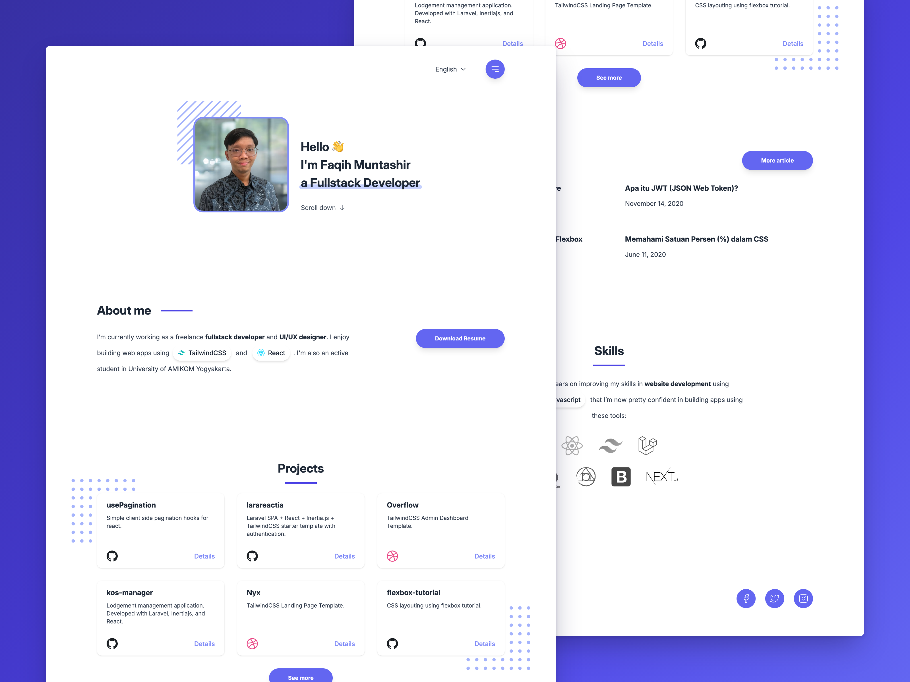

# Fama

A personal portfolio template built with React and Tailwind CSS 4. Fill in your
name, photo, projects, blog posts and skills, and it builds a fast static site in
English and Indonesian.



See it in use at <https://fama.itsfaqih.dev/>, the author's own portfolio.

## Features

- **Static HTML.** React renders every page at build time, one page per
  language (`/` and `/id/`). The browser gets about 4 KB of script.
- **Works without JavaScript.** The menu, the language switch and every section
  work with scripts turned off. The entrance animations are plain CSS. Scripts
  add the reveal on scroll, smooth scrolling and keyboard focus in the menu.
- **Fast on slow networks.** A first visit downloads about 58 KB. In Lighthouse's
  simulated phone, the main content appears in 2.1 s on Regular 3G and 2.8 s on
  DevTools' slower 3G preset.
- **Animated.** The hero, sections and full-screen menu animate in, and the
  animations turn off for visitors who ask for reduced motion.
- **Tested.** Unit, component and built-site tests, plus lint and type checks,
  run in CI on every push.

## Getting started

You need [Vite+](https://viteplus.dev/) (`vp`). It reads `.node-version` and
`package.json` to provide the right Node.js (24 or newer) and pnpm (12).

1. Create your own copy of this repository, by forking it or with GitHub's
   **Use this template** button, and clone it.
2. Install the dependencies and the Chromium build the tests use:

   ```sh
   vp run setup
   ```

3. Start the dev server:

   ```sh
   vp run dev
   ```

   It serves the site at <https://fama.localhost> through
   [portless](https://github.com/vercel-labs/portless). The name comes from the
   `portless` field in `package.json`. Change it to name your own local domain.

## Make it yours

All personal content lives in a few files. Edit them, then run the tests (see
[Check your changes](#check-your-changes)).

| What                                            | Where                                             |
| ----------------------------------------------- | ------------------------------------------------- |
| Name, job title and photo                       | `src/data/header.ts` and `public/img/`            |
| Resume link                                     | `src/data/about.ts`                               |
| Projects and the **See more** link              | `src/data/projects.ts`                            |
| Blog posts and the **More article** link        | `src/data/blogs.ts`                               |
| Skill logos and their links                     | `src/data/skills.tsx`                             |
| Email and GitHub, LinkedIn, Dribbble links      | `src/data/contact.ts`                             |
| Greeting, section titles, About and Skills text | `src/localization/en/` and `src/localization/id/` |
| Page title and description                      | `index.html`                                      |
| App name for home-screen installs               | `public/manifest.json`                            |
| README preview image                            | `.github/preview.png`                             |

The resume, **See more** and **More article** links are optional. Leave one out
and its button disappears. Each project's `type` picks the icon on its card:
`github`, `dribbble`, `figma` or `web`. The three social networks are fixed in
`src/components/organisms/Contact/types.ts`; change them there and in the
Contact component.

### Profile photo

The photo ships in three files, so each screen downloads only the size it needs:

| File                         | Size      | Format                                   |
| ---------------------------- | --------- | ---------------------------------------- |
| `public/img/person.jpg`      | 480 × 480 | JPEG, for browsers without AVIF          |
| `public/img/person.avif`     | 480 × 480 | AVIF, for large and high-density screens |
| `public/img/person-240.avif` | 240 × 240 | AVIF, for phones                         |

To make them from a square photo with [ffmpeg](https://ffmpeg.org/) and
`avifenc` from [libavif](https://github.com/AOMediaCodec/libavif):

```sh
ffmpeg -i photo.jpg -vf scale=480:480:flags=lanczos -q:v 3 public/img/person.jpg
ffmpeg -i photo.jpg -vf scale=480:480:flags=lanczos /tmp/person-480.png
ffmpeg -i photo.jpg -vf scale=240:240:flags=lanczos /tmp/person-240.png
avifenc -q 85 -y 444 -s 0 /tmp/person-480.png public/img/person.avif
avifenc -q 85 -y 444 -s 0 /tmp/person-240.png public/img/person-240.avif
```

Keep the file names, or update the paths in `src/data/header.ts`.

### Skill logos

Logos are SVG files in `public/icons/`. To add one:

1. Save it as `public/icons/<name>.svg`.
2. Add its `viewBox` width and height to the `logos` table in
   `src/components/atoms/Logo/index.tsx`. A test fails if the two disagree.
3. Use it as `<Logo name="<name>" height={48} />` in `src/data/skills.tsx` or in the
   localized About and Skills text.

### Text and the font

The site uses [Inter](https://rsms.me/inter/), trimmed to only the characters
the pages show, which keeps the font at 25 KB. New text can bring in a character
the font doesn't have yet. When it does, the site test
`Every character on / is in the subset font` fails and lists the missing
characters. To add them:

1. Add the characters to the `unicode-range` of the `@font-face` rule in
   `src/assets/css/styles.css`.
2. Run `vp run font`. It downloads Inter and writes the trimmed font to
   `src/assets/fonts/`. It needs [uv](https://docs.astral.sh/uv/).
3. Commit the updated stylesheet and font.

Emoji are drawn by the system's emoji font and need no change.

### Languages

The languages are listed in `src/contexts/language.ts`, and each gets its own
page. Their text lives in `src/localization/<language>/`. Button labels such as
**See more** are translated in the section components under
`src/components/organisms/`.

## Check your changes

```sh
vp run lint
vp run test
vp run test:components
vp run test:site
```

`test:site` builds the site and checks the real pages, with and without
JavaScript.

## Scripts

| Command                  | Description                                                    |
| ------------------------ | -------------------------------------------------------------- |
| `vp run setup`           | Install dependencies and the Chromium build the tests use.     |
| `vp run dev`             | Start the dev server at `https://fama.localhost` (portless).   |
| `vp run build`           | Build the static site into `dist/`.                            |
| `vp run preview`         | Serve the production build locally on a free port.             |
| `vp run test`            | Run the unit tests (shuffled).                                 |
| `vp run test:components` | Run the component tests in headless Chromium.                  |
| `vp run test:site`       | Build the site and test the generated pages.                   |
| `vp run lint`            | Run every lint check: Oxlint, tsc, Oxfmt, actionlint (Docker). |
| `vp run lint:fix`        | Apply Oxlint and Oxfmt fixes.                                  |
| `vp run font`            | Regenerate the trimmed Inter font from `styles.css`.           |
| `vp run perf`            | Measure page load with Lighthouse on simulated 3G.             |

## Project structure

- `src/data/` holds the site's content: profile, projects, blog posts, skills and contact.
- `src/localization/` holds the text for each language.
- `src/components/` holds the atoms, molecules, organisms and the page template.
- `src/pages/Home/` puts the content and the current language together.
- `src/entry-server.tsx` renders a page to HTML at build time.
- `src/client/` holds the small browser scripts for the menu, language switch,
  reveal animations and smooth scrolling.
- `src/assets/css/styles.css` is the Tailwind CSS 4 entry stylesheet, with the
  font and the animation styles.
- `index.html` is the HTML shell each page is rendered into.
- `tools/static-site/` writes one page per language at build time, and holds the
  built-site tests.
- `tools/fonts/` trims the Inter font. `tools/perf/` measures page load.
- `docs/` and `AGENTS.md` hold the project's conventions, written for coding agents.

## Deploy

`vp run build` writes a static site to `dist/`, which any static host can serve.

The repository is set up for [Cloudflare Pages](https://pages.cloudflare.com/)
in `wrangler.toml`. Change the project `name` there to your own. With Cloudflare's
Git integration, use these build settings:

- **Build command:** `pnpm install --frozen-lockfile && pnpm run build`
- **Build output directory:** `dist`
- **Production branch:** `main`

Cloudflare's build image has pnpm but not `vp`, so the build script runs the `vp`
binary from `node_modules`. To upload from your machine instead:

```sh
vp dlx wrangler pages project create <name> --production-branch main
vp dlx wrangler pages deploy --branch main
```

Skip the first command if the project already exists.

## Stack

- React 19 and TypeScript 7, rendered to static HTML at build time
- Tailwind CSS 4, configured in CSS
- Vite 8 through Vite+, with Oxlint and Oxfmt
- Vitest with Playwright for component and built-site tests

## License

[MIT](LICENSE). Keep the license notice, and replace the author's content, photo
and links with your own.
